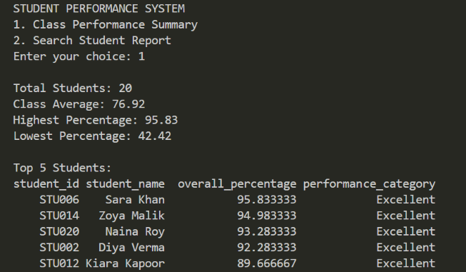
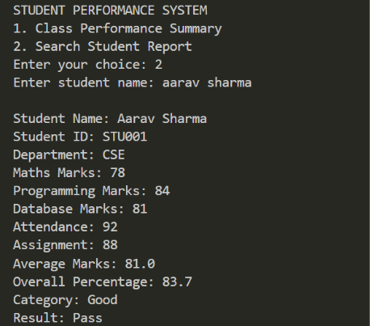
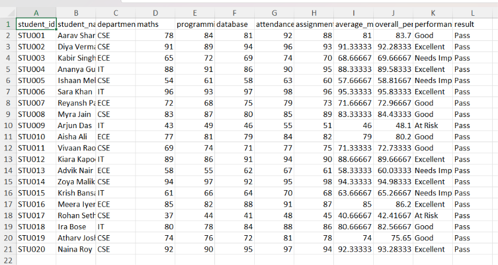

## 1. Project Title
* Project Name: Student Performance Analytics System
* Developer: Sareen Khan

## 2. Objective
The primary objective of this project is to automate the analysis of student academic performance. It was created to solve the challenge of manual grade calculation and reporting by processing student marks, attendance, and assignment records to generate accurate performance metrics, class summaries, and individual student reports efficiently.

## 3. Technologies Used
* Programming Language: Python
* Data Processing Libraries: Pandas, NumPy
* Development Environment: Visual Studio Code (VS Code)

## 4. Dataset Description
| Column | Meaning |
|---|---|
| student_id | Unique student code |
| student_name | Fictional student name |
| department | CSE, IT or ECE |
| maths / programming / database | Subject marks out of 100 |
| attendance_percent | Attendance from 0 to 100 |
| assignment_percent | Assignment score from 0 to 100 |

## 5. Implementation
The application is implemented in Python using a structured, modular approach:
1. Data Loading: Reads raw student data from an Excel file using Pandas (`pd.read_excel`).
2. Calculation: 
     * Average marks = (Maths + Programming + Database) / 3.
     * Overall percentage = (Average marks × 0.70) + (Attendance × 0.15) + (Assignment score × 0.15).
     * Category: 85+ Excellent; 70–84.99 Good; 50–69.99 Needs Improvement; below 50 At Risk.
     * Pass/Fail is based on average subject marks: 40 or more = Pass.
3. Interactive Interface: Built using user input controls and string methods 
     * Option 1: Class Performance Summary
     * Option 2: Search Student Report
4. Excel Export: Automatically serializes and saves the fully processed dataset containing all calculated metrics into a clean output file (`student_performance_report.xlsx`) `

## 6. Key Features
- Reads student records from a Excel spreadsheet.
- Calculates average marks and a weighted overall percentage.
- Assigns categories: Excellent, Good, Needs Improvement or At Risk.
- Marks students as Pass/Fail based on average subject marks (40 or more = Pass).
- Shows class statistics, department-wise averages and top five students.
- Exports detailed and summary Excel reports.

## 7. Output / Screenshots
* Class Performance Summary
  

* Search student Report
  

* Create Excel report
  

## 8. Final Outcome
The project successfully achieves its goal of automating student data analytics. It provides educators and administrators with a fast, reliable tool to gauge overall class performance, identify at-risk students, and export clean institutional reports without manual calculation errors.

## 9. Challenges & Learning

- Data Handling: Faced challenges in reading and processing Excel data using Pandas.
- Calculations: Learned to implement average marks, weighted percentages, and performance categories accurately.
- Conditional Logic: Understood how to classify students into different performance categories and determine Pass/Fail status.
- Report Generation: Learned to generate student summaries and export processed data to Excel.
- Problem-Solving:** Improved Python programming skills and understanding of structured, modular code.

## 10. GitHub Repository
* Repository Link: [https://github.com/Sareen-khan/Student_Performance_Analytics_System.git]

